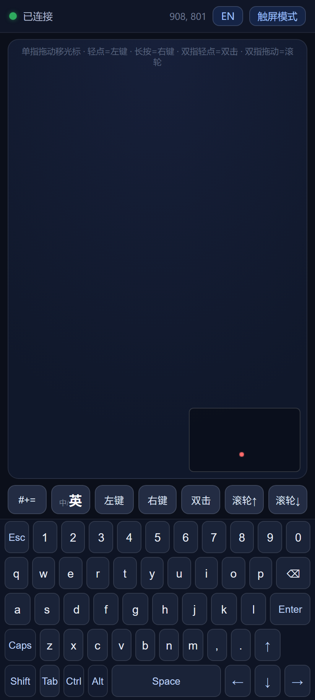
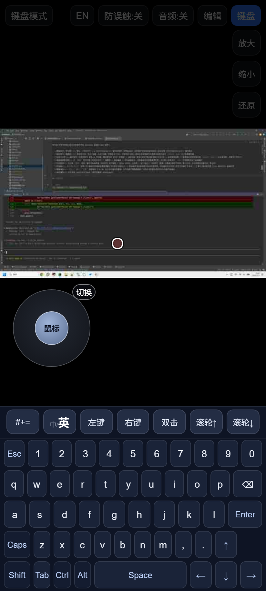
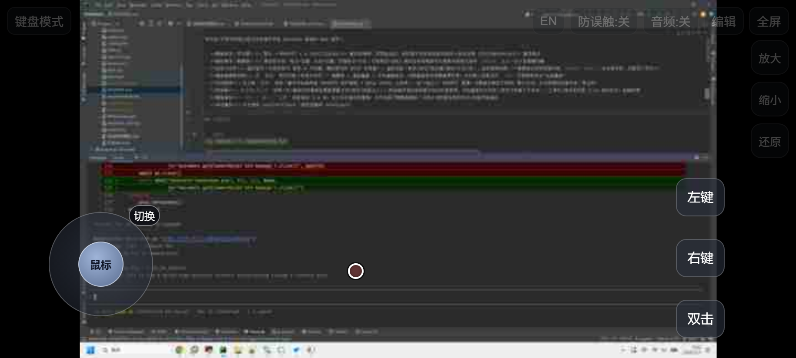
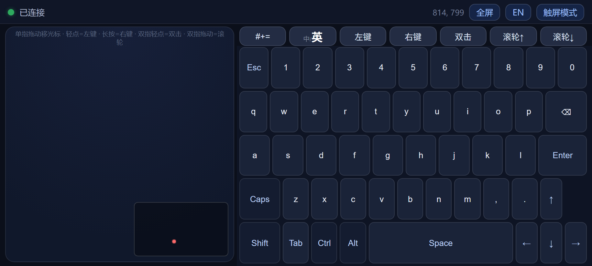
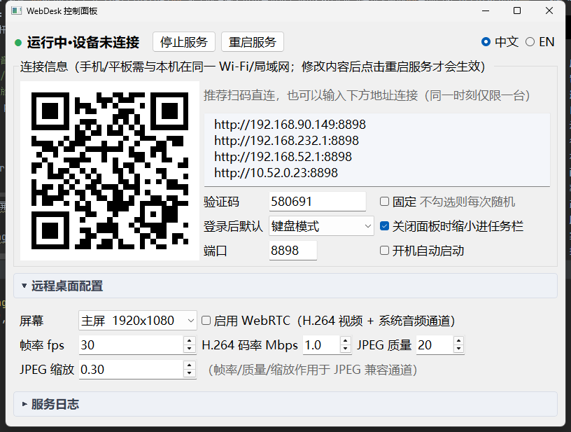

# WebDesk

[中文](README.md) · **English**

A web service that lets your phone/tablet browser view and control this Windows desktop remotely.

- **Dual-engine streaming**: **WebRTC + H.264 (libx264)** real-time encoding with bandwidth adaptation by default; **falls back automatically to JPEG/WebSocket** when the browser lacks WebRTC or the connection fails
- **Touchpad control**: drag to move the cursor, tap = left click, long press = right click, two-finger tap = double-click, two-finger drag = scroll; drag deltas are divided by the zoom factor and injected as absolute `mmove` coordinates, so pointing stays exact even when zoomed in
- **Custom widgets**: virtual joystick (tap the badge to swap mouse ↔ arrow keys; remappable to WASD or any keys in its properties) + virtual buttons (click/hold/combo/mouse/text/macro), freely drag-and-drop layout; **edits auto-save to the server's `layout.json`, shared across devices — no import/export**
- **Keyboard + touchpad view**: tap `Keyboard` to switch in the same page (no extra tab) = touchpad + virtual keyboard + physical keyboard forwarding; switching to the keyboard stops the video stream for zero bandwidth. The **bilingual CN/EN virtual keyboard** has dual symbol sets, full-width CN punctuation injected character-by-character via VK_PACKET straight into the remote side, and one-tap toggling of the remote IME between Chinese and English. Any second device opening `/kb` instantly works as a "wireless keyboard & mouse"
- **System audio**: the `Audio` button top-right toggles PC sound (WASAPI loopback capture → Opus 48kHz stereo) over an **independent** WebRTC channel, unaffected by the video engine; off by default, and turning it off releases the capture device (zero footprint)
- **Input guard**: a `Guard:On/Off` master switch (on = live picture but all screen taps/mouse/button injection blocked); with Guard on, mouse-mode sticks gray out automatically while arrow-key sticks still work (no collateral damage to game input); toolbar/zoom bar fade out after 2.6s idle, any tap restores them
- **Zoom**: top-right `Zoom in / Zoom out / Reset` buttons scale 1–4×; two fingers pan the picture when zoomed; widget buttons don't scale with the picture; the browser's own double-tap/pinch page zoom is suppressed
- **Game compatibility**: prefers pydirectinput (hardware scan-code SendInput)

## Screenshots

Phone (Chrome/Edge/Safari) and the desktop control panel:

| Keyboard mode · portrait | Touch mode · portrait |
|:---:|:---:|
|  |  |

| Touch mode · landscape | Keyboard mode · landscape |
|:---:|:---:|
|  |  |

<details>
<summary>What you're looking at</summary>

- **Portrait defaults to Keyboard mode** (touchpad on top, keyboard below); Touch mode in portrait shows the picture on top with a **keyboard docked at the bottom**
- **Landscape defaults to Touch mode** (fullscreen picture + floating joystick/quick buttons); tapping `Keyboard` switches to a **side-by-side layout: touchpad left, keyboard right**
- **The `Fullscreen` button only appears in landscape** (present in both modes): after entering fullscreen it stays highlighted as `Exit fullscreen`; fullscreen locks screen orientation — **exit fullscreen first, then rotate the phone to switch orientation**
- Hidden in portrait on touch devices (portrait fullscreen is pointless); see "Hidden address bar" below for the iPhone/iPad option

</details>

## Quick start

```bash
pip install -r requirements.txt
```

Then **double-click `启动控制面板.bat`** (or `python panel.py`) to open the control panel and click `Start service`.

Connect your phone/tablet to the same Wi-Fi as this PC, scan the QR code on the panel, or open `http://<this-PC's-IP>:8898` in the browser. On first use, allow it through Windows Firewall (or allow Python). CLI fans can just run `python main.py` — the panel detects and takes over manually started instances too.

## Control panel (panel.py)

Desktop management UI (PyQt5; the QR code needs the `qrcode` library — both are in requirements):



- **Start/stop service**: the service runs as a separate process, but **closing the panel window stops the service first** (no leftovers in the background); the status light shows live state and desktop resolution
- **Connection info**: lists all LAN addresses of this PC (default adapter first, port included in the URL, auto-refreshed and selectable for copying); the **current access code** is shown read-only in the "Access code" field (random codes update live); the QR code embeds `?pin=` so phones connect without typing the code; the info line also shows live **remote connection occupancy `n/1`** (refreshed by health polling)
- **Settings editing**: port / fixed access code / monitor (listed by real resolution) / FPS / H.264 bitrate / JPEG quality & scale / WebRTC switch / default view after connect; saving writes `config.json`, and changing port or code offers a one-click restart
- **Service log**: collapsible pane (collapsed by default, click the title row; auto-expands when a message says "see log"), tailing `webdesk.log` in real time (line-visible, keeps updating while collapsed)
- Checking "Start service automatically when panel opens" launches the service every time (remembered in `panel_state.json`)
- Bilingual UI (top-right `中文 / EN`)

## Configuration (config.json)

| Field | Description |
|---|---|
| `pin` | Fixed access code; **leave empty and a random 6-digit code is generated on every start** (shown on the panel, changes on restart) |
| `port` | Listening port, default 8898 |
| `monitor` | `"primary"` = main monitor (default) / number = monitor index (mss enumeration order; the panel dropdown lists each screen) |
| `fps` / `quality` / `scale` | Default FPS / JPEG quality / JPEG-mode resolution scale |
| `bitrate` | Initial max WebRTC bitrate (bps), default 6000000; actual rate adapts to bandwidth estimation |
| `webrtc` | `false` disables WebRTC globally (JPEG only) |
| `default_view` | Default view after connecting: `"remote"` = Touch mode (default) / `"kb"` = Keyboard mode (on touch devices, automatic orientation switching takes precedence) |

## Usage notes

- **Access code**: every device must pass the access code first. Opening the address manually pops a prompt (the code is shown on the control panel — random 6 digits per start by default, changed on restart, to keep snoopers out); **opening via the panel's QR code auto-fills the code**. The code lives only in the local `runtime.json` and is never served over any network endpoint; WebRTC session tokens are only issued after verification, so connecting behind the page gets you nothing
- **Single connection**: only 1 remote connection at a time. A second device sees "Another device is in use" and retries every 5s, taking over automatically when the other disconnects; abnormal drops (e.g. closing the phone page) are released by the WebSocket heartbeat within ~40s — in a hurry, click "Stop service" on the panel for an instant reset. `Touch ⇄ Keyboard` within one browser tab is a same-page switch sharing that single connection — **it doesn't take two slots**; only separate tabs/devices compete. WebRTC video/audio channels are token-protected as well
- **Automatic orientation switching** (touch devices): portrait → Keyboard mode, landscape → Touch mode; manually tapping `Keyboard/Touch` takes over and rotations no longer flip the view (reload restores automatic). Touch devices **also auto-enter fullscreen in landscape** (browser permitting; after a manual exit it won't auto-reopen during that landscape session)
- Top text buttons: `Guard:On/Off` (on = look, don't touch), `Audio` (off by default, highlighted blue = on), `Edit` widgets, `Fullscreen` (landscape only); in portrait there's also a `Keys` bottom-dock toggle top-right, and the `Keyboard` button top-left switches views; quality/FPS are configured in `config.json`
- **Keyboard + touchpad view (tap `Keyboard` to switch in the same page; also directly at `http://<this-PC's-IP>:8898/kb`)**: a pure input peripheral (the video stream stops while in keyboard mode, zero encoding; portrait = touchpad above keyboard, **landscape automatically becomes touchpad-left/keyboard-right**, key heights share the remaining space so even small landscape screens fit every key); touchpad gestures match the main page + the **bilingual CN/EN virtual keyboard** (letters lowercase by default, uppercase state shows uppercase; the `#+=` symbols page maps CN/EN sets cell-for-cell so switching doesn't move your hands, CN-mode punctuation keys are full-width and injected via VK_PACKET — no clipboard, no remote IME candidate interference; the `中/英` key can also switch the remote system IME language; Shift/Caps/Ctrl·Alt latching, Caps auto-converges with the remote's real LED state; arrow keys laid out like a 60% board); **opening it in a laptop browser lets you type on the physical keyboard too** (keys forwarded live, combos included)
- **Portrait bottom keyboard dock**: in portrait Touch mode a full virtual keyboard (identical to Keyboard mode) docks at the bottom by default; the picture moves up to fill the rest; toggle with the top-right `Keys` button (remembered)
- Audio uses loopback capture of the system default playback device: after switching the default device, tap `Audio` again; on iPhone/Safari you need one more tap on the page's play icon (autoplay policy)
- **Hidden address bar**: the `Fullscreen` button **only appears in landscape** (portrait fullscreen is pointless) and is present top-right in both modes; after entering fullscreen the button becomes a selected `Exit fullscreen` — **fullscreen locks screen orientation; tap `Exit fullscreen` first, then rotate the phone to switch orientation**; on touch devices the page usually auto-fullscreens when opened in landscape; iPhone/iPad (Safari) can't fullscreen web pages — use Share → **Add to Home Screen**; launching from the home-screen icon gives a full-screen page without the address bar (manifest configured)
- When zoomed (>1×), two fingers pan the picture; at 1×, two fingers scroll the page
- `Edit` enters edit mode: drag widgets into place, tap a widget to edit it, `+ Button / + Stick` to add; every change auto-saves to the server's `layout.json` and is restored on reconnect after switching devices or clearing cache; portrait and landscape keep separate layouts
- Macro step example (Ctrl+Z): `[{"k":"ctrl","d":"down"},{"k":"z","d":"tap"},{"k":"ctrl","d":"up"}]`, `{"ms":50}` is a delay

## Packaging into a single exe (deploy to other PCs)

Double-click `打包exe.bat` (needs Python 3.9+ and `pip install pyinstaller` on the build machine); produces `dist\WebDesk.exe` (~130MB, includes all dependencies and the web frontend):

- **The target PC needs no Python installation** — copy it over and double-click (Windows 10/11 x64; a limitation of the Python 3.9+ runtime, no Win7 support)
- Double-click = open the control panel; "Start service" on the panel = the exe re-launches itself with `--service` as a detached process (same as development mode)
- `config.json / layout.json / runtime.json / webdesk.log` are created **next to the exe** automatically (after first run); you can also pre-copy a `config.json` to preset the port / fixed access code
- On first run click "Allow access" in the Windows Firewall prompt (otherwise phones can't connect); some antivirus tools may false-positive on PyInstaller single files — whitelist it, or switch to `--onedir` mode (faster start, fewer false positives)
- Development is unaffected: `python panel.py` / `python main.py` still work as before

## Notes

- **WebRTC engine**: 1080p H.264 full-resolution encoding (x264 ultrafast + zerolatency); measured 12–20 FPS steadily over LAN (per `fps`), ~100–200ms latency; natively supported by mobile browsers (Chrome/Edge/Safari/WeChat in-app)
- **Automatic fallback**: on connection failure or no video for 6s it switches back to JPEG; input always goes through WebSocket and is unaffected
- WebRTC uses **UDP** — Windows Firewall may prompt again on first run; please allow
- **On-demand capture, zero idle footprint**: with no device connected, a connected device sitting in keyboard view (no streaming), or an unverified session, the capture thread sleeps entirely — measured idle CPU <1%, zero encoding, zero frames; capture/encoding only happens when there are consumers; while idle the only traffic is the panel polling local `/health`, nothing egresses
- Encoding runs on the CPU; for higher FPS/lower load, lower `scale` to 0.75
- Modern Chrome / Edge / Safari recommended; for HTTPS/public-internet access, put a reverse proxy with TLS in front

## Developer notes

- `docs/shot.py`: README screenshot generator (headless Chrome + CDP touch emulation for the mobile UIs, Win32 API for the control panel). With the service running and the single connection free, run `python docs/shot.py "http://127.0.0.1:<port>/?pin=<access-code>"` to regenerate `docs/images/*.png`
