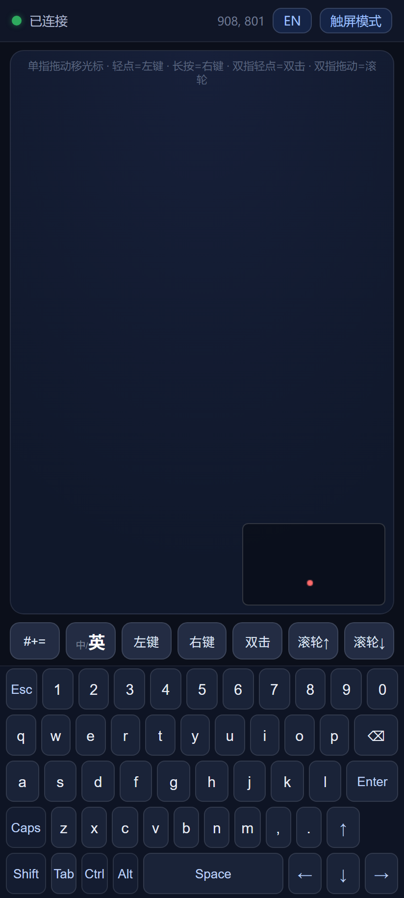
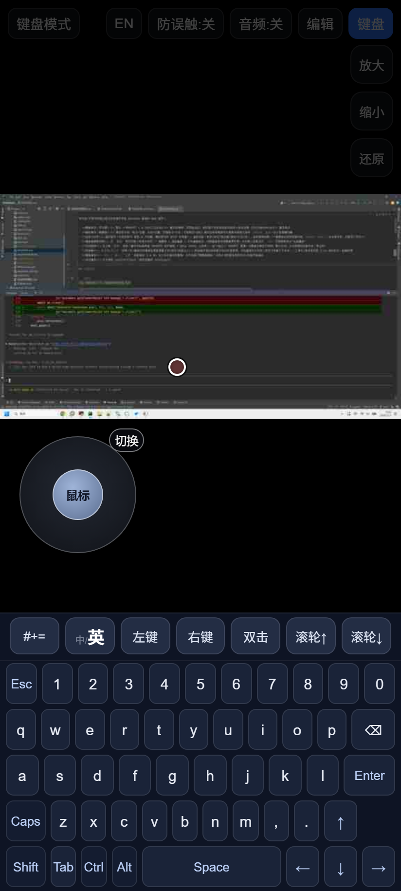
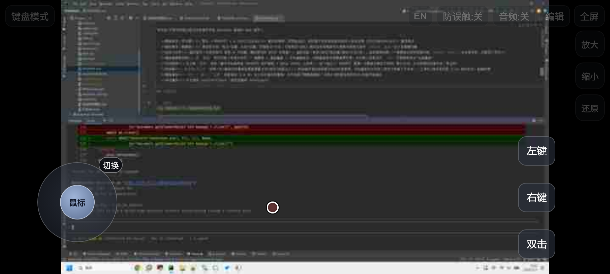
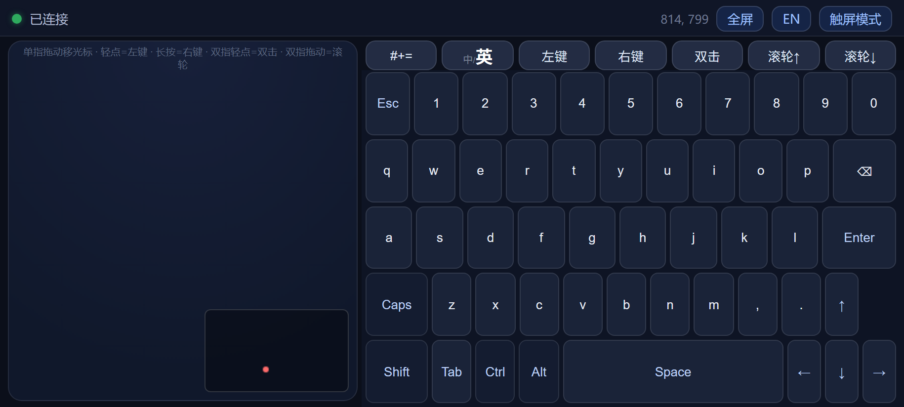
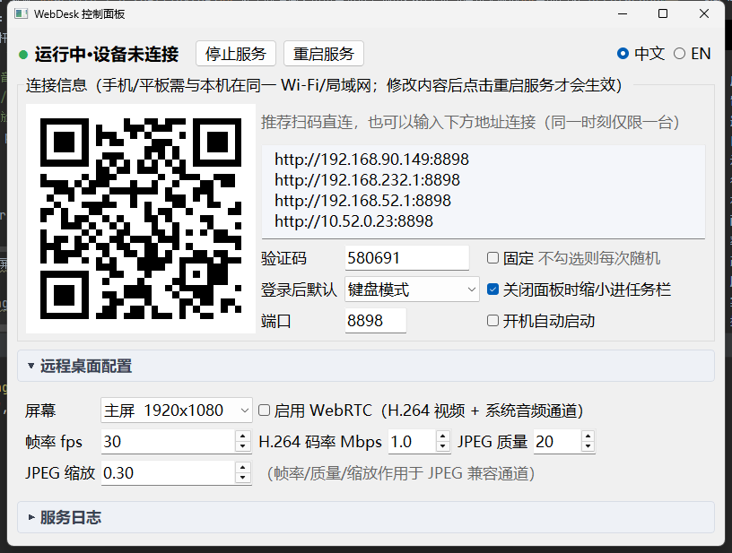

# WebDesk

**中文** · [English](README.en.md)

用手机/平板浏览器远程访问并操作本机 Windows 桌面的 Web 服务。

- **画面串流（双引擎）**：默认 **WebRTC + H.264(libx264)** 硬实时编码、带宽自适应；浏览器不支持或连接失败时**自动回退 JPEG/WebSocket** 兼容模式
- **触控操作（触摸板）**：拖动移光标、轻点=左键、长按=右键、双指轻点=双击、双指拖动=滚轮；拖动位移按缩放反比换算并用绝对坐标 `mmove` 注入，放大后指哪打哪
- **自定义控件**：虚拟摇杆（点角标即切 鼠标 ↔ 方向键，属性里可改 WASD 任意键）+ 虚拟按钮（单击/按住/组合键/鼠标/文本/宏），自由拖拽布局；**编辑自动保存到服务端 `layout.json`，多设备共享，无需导入导出**
- **键盘触摸板视图**：点 `键盘模式` 同页切换（非新开标页）= 触摸板 + 虚拟键盘 + 实体键盘转发，切到键盘即停推画面零带宽；**中英双页虚拟键盘**（字母/数字/符号双符号集，中文模式句读全角、逐字符 VK_PACKET 注入直达远端，可一键切换远端输入法中英文）；任何第二设备访问 `/kb` 亦即插即用当"无线键鼠"
- **系统音频**：右上角 `音频` 按钮一键开关电脑声音（WASAPI 回环捕获 → Opus 48kHz 立体声），走**独立** WebRTC 通道、与画面引擎互不影响；默认关闭，关闭即释放采集设备（零占用）
- **防误触**：`防误触:开/关` 总闸（开=画面实时刷新但屏蔽屏幕点按/鼠标/按钮注入）；防误触开启时鼠标摇杆自动灰显禁用，方向键摇杆仍可用（游戏方向输入不误伤）；工具栏/缩放条闲置 2.6s 自动变淡，轻触恢复
- **画面缩放**：右上角 `放大 / 缩小 / 还原` 按钮缩放 1~4 倍，放大后双指平移画面；控件按钮不随画面缩放；已阻止浏览器自身的双击/双指页面缩放
- **游戏兼容**：优先使用 pydirectinput（硬件扫描码 SendInput）

## 界面预览

手机（Chrome/Edge/Safari）与电脑控制面板：

| 竖屏 · 键盘模式 | 竖屏 · 触屏模式 |
|:---:|:---:|
|  |  |

| 横屏 · 触屏模式 | 横屏 · 键盘模式 |
|:---:|:---:|
|  |  |

<details>
<summary>各视图要点</summary>

- **竖屏默认进键盘模式**（触摸板在上、键盘在下）；竖屏触屏模式则画面在上、**底栏停靠键盘**在下
- **横屏默认进触屏模式**（全屏画面 + 摇杆/快捷按钮浮层）；点 `键盘模式` 可切成**触摸板居左、键盘居右**的左右布局
- **`全屏` 按钮仅横屏显示**（触屏/键盘两模式都有）：点击进入全屏后按钮变选中态显示 `退出全屏`；全屏会锁定屏幕方向，**需先退出全屏才能转动手机切换横竖屏**
- 竖屏隐藏 `全屏` 按钮：竖屏全屏无意义；iPhone/iPad 无地址栏方案见下文「隐藏地址栏」

</details>

## 快速开始

```bash
pip install -r requirements.txt
```

然后**双击 `启动控制面板.bat`**（或 `python panel.py`）打开控制面板，点 `启动服务`。

手机/平板与本机连同一 Wi-Fi，扫面板上的二维码、或浏览器打开面板显示的
`http://<本机IP>:8898` 即可。首次使用需在 Windows 防火墙放行（或允许 Python 通过防火墙）。
命令行党也可直接 `python main.py`，面板对手动启动的实例同样能识别并接管。

## 控制面板（panel.py）

桌面端管理界面（PyQt5，二维码需 `qrcode` 库，均已含在 requirements）：



- **启动/停止服务**：服务是独立进程，但**关闭面板窗口会先自动停止服务再退出**（不留后台运行）；面板状态灯实时显示运行状态与桌面分辨率
- **连接信息**：只列本机全部局域网地址（默认网卡排最前，端口含在 URL 里，信息自动实时刷新、可直接选中复制）；**当前验证码**在配置区「验证码」框内只读展示（随机码实时更新）；二维码自带 `?pin=`，手机扫码直连免输验证码；提示行右侧实时展示**远程连接占用 `n/1`**（随健康轮询刷新，"同一时刻仅限 1 台"标注在区域标题上）
- **配置编辑**：端口/固定验证码/屏幕选择（按真实分辨率列出）/帧率/H.264 码率/JPEG 质量缩放/WebRTC 开关/登录后默认视图，保存即写 `config.json`，改端口或验证码会提示一键重启
- **服务日志**：折叠窗（默认折叠，点标题行展开；提示"详见日志"时自动展开），实时尾读 `webdesk.log`（服务以独立进程运行，日志缓冲已关断，逐行可见；折叠时后台照常更新，展开即见最新）
- 勾选「打开面板时自动启动服务」后，每次开面板即自动拉起服务（记忆在 `panel_state.json`）
- 支持中/英文界面切换（右上角 `中文 / EN`）

## 配置（config.json）

| 字段 | 说明 |
|---|---|
| `pin` | 固定验证码；**留空则每次启动随机生成 6 位验证码**（面板上查看，重启后更换） |
| `port` | 监听端口，默认 8898 |
| `monitor` | `"primary"`=主屏（默认）/ 数字=显示器序号（对应 mss 枚举序，面板下拉每屏一项） |
| `fps` / `quality` / `scale` | 默认帧率 / JPEG 质量 / JPEG 模式分辨率缩放 |
| `bitrate` | WebRTC 初始最大码率(bps)，默认 6000000；实际由带宽估计自适应 |
| `webrtc` | `false` 可全局禁用 WebRTC（仅 JPEG） |
| `default_view` | 连接后默认视图：`"remote"`=触屏模式（默认）/ `"kb"`=键盘模式（触屏设备自动横竖屏切换优先于此项） |

## 使用要点

- **连接验证码**：任何设备连入都必须先输验证码。手动在浏览器输入地址的，页面会弹出输码框（验证码在本机控制面板上查看，默认每次启动随机 6 位，重启即换，防蹭防偷看）；**扫控制面板上的二维码打开则验证码自动带入、免输入**。验证码只存在本机 `runtime.json`，不通过任何网络接口下发；WebRTC 视频/音频通道的会话令牌也只在验证通过后才发放，绕过页面直接连也拉不到流
- **单连接限制**：同一时刻只允许 1 个远程连接。第二台设备连入会看到「已有设备正在使用」并每 5 秒自动重试，对方断开后自动顶上；异常断链（如手机直接关页面）约 40 秒内由 WebSocket 心跳自动释放名额，急用时在控制面板点「停止服务」立即清场。同一浏览器内 `触屏模式 ⇄ 键盘模式` 是同页切换、共用这一条连接，**不占两个名额**；只有跨标签页/跨设备各开一个才会互相占用。WebRTC 视频/音频通道也受会话令牌保护，绕过页面直接连不进来
- **横竖屏自动切换**（触屏设备）：竖屏自动进键盘模式、横屏自动进触屏模式；手动点 `键盘模式/触屏模式` 即接管，本次页面内旋转不再自动翻转（刷新后恢复自动）。触屏设备**横屏还会自动尝试进全屏**（需浏览器允许；手动退出后本次横屏内不再自动重开）
- 顶部文字按钮：`防误触:开/关`（开=只看不碰）、`音频`（默认关，点一下高亮蓝色=已开）、`编辑` 控件、`全屏`（仅横屏）、竖屏右上另有 `键盘` 底栏停靠开关；左上角 `键盘模式` 按钮切换视图；画质/帧率等均在 `config.json` 中配置
- **键盘触摸板视图（点 `键盘模式` 按钮同页切换；也可用 `http://<本机IP>:8898/kb` 直达）**：纯输入外设（切到键盘即停推画面、零编码开销；竖屏=触摸板在上键盘在下，**横屏自动改为触摸板居左、键盘居右的左右布局**，键高按剩余空间均分，小横屏也能完整放下全部按键），触摸板手势与主页面一致 + **中英双页虚拟键盘**（字母默认小写、大写态显大写；`#+=` 符号页中英同格一一对应、切换不挪手，中文模式句读键帽全角并经 VK_PACKET 逐字符注入——不占剪贴板、不经远端输入法候选框；`中/英` 键可顺带切换远端系统输入法中英文；Shift/Caps/Ctrl·Alt 锁存组合键，Caps 与远端真实灯态自动收敛；方向键按 60% 机械键盘排法）；**用笔记本浏览器打开还能直接敲实体键盘**（按键实时转发，含组合键）
- **竖屏底栏键盘停靠**：竖屏触屏模式默认在屏幕下方停靠一套完整虚拟键盘（与键盘模式同款），画面上移铺满剩余区域；点右上 `键盘` 按钮开关（记忆选择）
- 音频走系统默认播放设备的回环捕获：切换默认播放设备后需重新点一次 `音频`；iPhone/Safari 首次需在页面上再点一下播放图标（自动播放策略）
- **隐藏地址栏**：`全屏` 按钮**仅横屏显示**（竖屏全屏无意义），触屏/键盘两模式右上角都有；点击进入全屏后按钮为选中态显示 `退出全屏`——**全屏会锁定屏幕方向，先点 `退出全屏` 才能转动手机切换横竖屏**；触屏设备横屏打开页面通常已自动全屏；iPhone/iPad(Safari) 不支持网页全屏，请用 分享 → **添加到主屏幕**，从主屏幕图标启动即为全屏无地址栏（manifest 已配置）
- 放大状态(>1x)下双指=平移画面；1x 下双指=滚动页面
- `编辑` 进入编辑模式：拖动控件摆位置，点控件改属性，`＋按钮 / ＋摇杆` 添加；每次改动自动存到服务端 `layout.json`，换设备/清缓存后重连自动恢复；横竖屏各记一套布局
- 宏步骤示例（Ctrl+Z）：`[{"k":"ctrl","d":"down"},{"k":"z","d":"tap"},{"k":"ctrl","d":"up"}]`，`{"ms":50}` 为延时

## 打包为单文件 exe（换机部署）

双击 `打包exe.bat`（需本机已装 Python 3.9+ 与 `pip install pyinstaller`），产物 `dist\WebDesk.exe`（约 130MB，含全部依赖与前端页面）：

- **目标电脑无需安装 Python**，拷过去双击即用（Windows 10/11 x64；Python 3.9+ 运行时的限制，不支持 Win7）
- 双击 = 打开控制面板；面板「启动服务」= exe 以 `--service` 参数自举分离进程（与开发态行为一致）
- `config.json / layout.json / runtime.json / webdesk.log` 自动创建于 **exe 同目录**（首次运行后出现）；也可先拷一份 `config.json` 预设端口/固定验证码
- 首次运行请在 Windows 防火墙弹窗点「允许访问」（否则手机连不进来）；个别杀毒软件对 PyInstaller 单文件可能误报，加白名单即可，或改用 `--onedir` 目录模式（启动更快、误报更少）
- 开发态调试不受影响：`python panel.py` / `python main.py` 照旧

## 说明

- **WebRTC 引擎**：1080p H.264 全分辨率编码（x264 ultrafast + zerolatency），实测局域网稳定 12~20fps（随 `fps` 配置），延迟约 100~200ms；移动端浏览器（Chrome/Edge/Safari/微信内置）原生支持
- **自动回退**：连接失败或 6 秒无画面自动切回 JPEG 模式，输入控制始终走 WebSocket 不受影响
- WebRTC 使用 **UDP**，首次运行 Windows 防火墙可能再次弹窗，请允许
- **按需抓屏，闲置零占用**：无设备连接、连接但停在键盘视图（不推流）、或未通过验证码时，抓屏线程整体休眠——实测空载 CPU <1%、零编码、零帧；画面只在有消费者时抓屏/编码，带宽上服务空闲期仅有面板对本机 `/health` 的轮询，无对外流量
- 编码在 CPU 上进行；如需更高帧率/更低占用，可将 `scale` 降至 0.75
- 建议 Chrome / Edge / Safari 新版浏览器；HTTPS/公网接入请自行加反代与 TLS

## 开发说明

- `docs/shot.py`：README 截图生成脚本（无头 Chrome + CDP 触屏仿真拍手机界面，Win32 API 拍控制面板）；服务运行且单连接空闲时执行 `python docs/shot.py "http://127.0.0.1:<端口>/?pin=<验证码>"` 即可重新生成 `docs/images/*.png`
